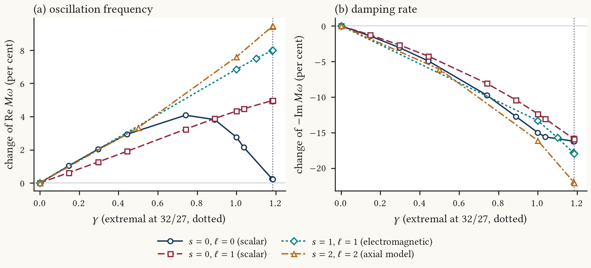

<!-- Author: Dr. Denys Dutykh (Mathematics Department, Khalifa University of Science and Technology, Abu Dhabi, UAE) -->

# ASafeGravity: quasinormal modes of Planck stars, Bonanno–Reuter and Hayward black holes



The least damped oscillating mode of the Hayward black hole, read from the reports of `qnmdata/Paper3HaywardBH/`, as
the deformation parameter γ grows from the Schwarzschild black hole (γ = 0) to the extremal one (γ = 32/27, dotted
line), for the scalar field with ℓ = 0 and ℓ = 1, the electromagnetic field with ℓ = 1 and the axial model with
ℓ = 2. Panel (a) shows the relative change of the oscillation frequency Re Mω and panel (b) that of the damping rate
−Im Mω, both measured from their Schwarzschild values (0.110455 − 0.104896i, 0.292936 − 0.097660i,
0.248263 − 0.092488i and 0.373672 − 0.088962i). The deformation lowers the damping of every mode, by 16 to 22 per cent
at extremality, and raises the frequency, by up to 9.5 per cent for the axial quadrupole, except for the scalar
monopole, whose frequency rises up to γ ≈ 0.74 and then falls back almost to its Schwarzschild value.

ASafeGravity holds the Maple material and the computed spectra of a series of three articles on the quasinormal modes
of black holes whose metric is improved by a running Newton coupling, as in asymptotically safe gravity: Planck stars
(Paper 1), Bonanno–Reuter black holes (Paper 2) and Hayward black holes (Paper 3). For massless scalar (s = 0),
electromagnetic (s = 1) and gravitational (s = 2) perturbations, the radial equation is compactified onto the interval
−1 ⩽ y ⩽ 1, its quasinormal boundary conditions are built into a factorisation of the solution, and a Chebyshev
collocation in multiprecision arithmetic gives a quadratic eigenvalue problem whose converged eigenvalues are the
quasinormal frequencies. The repository holds the Maple worksheets of the derivations for the three papers, the Maple
procedures that assemble the matrices for Papers 1 and 2, and 186 reports of computed spectra; the solution of the
eigenvalue problem, done in MATLAB with the Advanpix toolbox for the articles, is not part of it. The articles, by
Davide Batic, Denys Dutykh and Fabio Scardigli (Papers 1 and 2) and by Davide Batic and Denys Dutykh (Paper 3), are
cited below.

## The three geometries

The three black holes are static and spherically symmetric, ds² = −f dt² + dr²/f + r² dΩ². Papers 1 and 2 use the
Newton coupling that runs with the radius, in Planck units (r in Planck lengths, M the dimensionless geometric mass):

```text
f(r) = 1 − 2M G(r)/r,        G(r) = r³ / ( r³ + α (r + γM) ),

Paper 1, Planck stars:              α = −41/(10π),    γ = 1/2 and 9/2,    M = 1
Paper 2, Bonanno–Reuter black holes: α = 118/(15π),    γ = 9/2
```

In Paper 1 the negative α matches the effective Newtonian potential of the one-loop effective field theory; the
coupling then does not reach the ultraviolet fixed point of asymptotically safe gravity, and the article reads the
geometry as an effective metric of scale-dependent gravity. In Paper 2 the positive α of Bonanno and Reuter gives a
regular black hole, with two horizons above an extremal mass and one double horizon at that mass (M = 3.50274 for
γ = 9/2 in the reports). Paper 3 uses the Hayward metric, in the rescaled radius ρ = r/M:

```text
f(ρ) = 1 − 2ρ² / (ρ³ + γ),        horizons:  ρ_h³ − 2ρ_h² + γ = 0,
```

with two horizons for 0 < γ < 32/27, a double one at ρ = 4/3 for γ = 32/27, and none beyond. In all three papers each
perturbation obeys, with the time dependence e^(−iωt) and spherical harmonics of degree ℓ ⩾ s,

```text
f d/dr( f dψ/dr ) + [ ω² − U(r) ] ψ = 0,        U(r) = f(r) [ ε f′(r)/r + ℓ(ℓ + 1)/r² ],        ε = 1 − s²,
```

with ψ ingoing at the event horizon and outgoing at infinity; for s = 2 the Hayward article defines its spin-2 equation
by this potential, an axial model rather than a consequence of a perturbed action. After the asymptotic behaviour at
both ends has been factored out, the regular part of ψ is expanded in N Chebyshev polynomials and collocated at the N
roots y_i = cos((2i − 1)π/(2N)), which gives

```text
( M0 + i ω M1 + ω² M2 ) a = 0
```

with three real N × N matrices; the procedures export `M1` without the factor i, which multiplies it when the problem is
solved.

## Quick start

The procedures of `matlab/` are Maple procedures, despite the name of the folder: they assemble the three matrices for
MATLAB. Each writes `data/M0_N.mat`, `data/M1_N.mat` and `data/M2_N.mat`, in the ASCII format of MATLAB, into the folder
of the path it is given, which must exist. To recompute the report of Paper 1 for s = 0, ℓ = 0, γ = 1/2 and M = 1,
whose header lists the resolutions 200, 190 and 180, from the folder of the repository:

```bash
mkdir -p data
```

```maple
read "matlab/Paper1NegAlpha/matrixassembler.mpl":
MatrixAssembler(200, 200, 0, 0, 0.5, 1.0, "/absolute/path/to/ASafeGravity"):
MatrixAssembler(200, 190, 0, 0, 0.5, 1.0, "/absolute/path/to/ASafeGravity"):
MatrixAssembler(200, 180, 0, 0, 0.5, 1.0, "/absolute/path/to/ASafeGravity"):
```

The arguments of the non-extremal procedures (Papers 1 and 2) are the number of digits `d`, the number of Chebyshev
modes `N` (the size of the matrices), the spin `s`, the multipole `L` (that is ℓ), the parameter `g` (that is γ), the
mass `M` and the path `p`; they find the event horizon by `fsolve`, from r = 2.6 in Paper 1 and r = 9.03 in Paper 2,
and print it. The extremal procedure of Paper 2, `matlab/Paper2PosAlpha/extreme/matrixassembler.mpl`, takes only
`(d, N, s, L, p)`: it sets γ = 9/2 and solves for the extremal mass and the double horizon (searched between 4 and 5),
which it prints. The eigenvalue problem is then solved in MATLAB with the Advanpix Multiprecision Computing Toolbox, as
in the articles:

```matlab
addpath('/path/to/advanpix');                     % Multiprecision Computing Toolbox
for N = [200, 190, 180]
    mp.Digits(N);
    M0 = mp.read(sprintf('data/M0_%d.mat', N));
    M1 = mp.read(sprintf('data/M1_%d.mat', N));
    M2 = mp.read(sprintf('data/M2_%d.mat', N));
    omega = polyeig(M0, mp('1i')*M1, M2);         % (M0 + i omega M1 + omega^2 M2) a = 0
    plot(real(omega), imag(omega), '.'), hold on
end
```

The quasinormal frequencies are the eigenvalues common to the three resolutions, which the reports list. The three
articles compute with 200 digits.

## The computed spectra

The folder `qnmdata/` holds one plain-text report per set of parameters:

| Folder | Content | Reports |
|---|---|---|
| `Paper1NegAlpha/s{0,1,2}/g{0_5,4_5}/` | Planck stars, γ = 1/2 and 9/2, M = 1, ten multipoles per spin (ℓ = 0 to 9 for s = 0, 1 to 10 for s = 1, 2 to 11 for s = 2) | 60 |
| `Paper2PosAlpha/extreme/s{0,1,2}/L*/` | extremal Bonanno–Reuter black hole, M = 3.50274 | 18 |
| `Paper2PosAlpha/nonextreme/s{0,1,2}/L*/M*/` | non-extremal Bonanno–Reuter black holes, several masses up to M = 1000, close to Schwarzschild | 55 |
| `Paper3HaywardBH/extreme/s{0,1,2}/L*/` | extremal Hayward black hole, γ = 32/27 | 18 |
| `Paper3HaywardBH/nearextreme/s0/L{0,1}/g59_50/` | Hayward black hole close to extremality, γ = 59/50 | 2 |
| `Paper3HaywardBH/nonextreme/s{0,1,2}/L*/g*/` | non-extremal Hayward black holes, several values of γ | 33 |

In the names, `s` and `L` give the spin and the multipole. The value of γ is written `g`, with the underscore as a
decimal point in Paper 1 (`g0_5` is γ = 0.5, `g4_5` is γ = 4.5) and as a fraction bar in Paper 3 (`g4_27` is
γ = 4/27, `g59_50` is γ = 59/50, `g0` and `g1` are 0 and 1). The mass is written `M`, with the underscore as a decimal
point (`M5_0` is M = 5, `M3_503` is M ≈ 3.503). The folder `Paper2PosAlpha/nonextreme/s0/L4/M5_0/` also holds the report
of M = 8, and `Paper3HaywardBH/nonextreme/s1/L1/g1/` a second report computed at the higher resolutions 400, 390 and 380,
which gives the same least damped mode.

Each report starts with the date, the parameters and the three resolutions (200, 190 and 180 in Paper 1, 400, 390 and
380 in Paper 2, 300, 290 and 280 in Paper 3), then lists the modes common to the three within the tolerance 10⁻⁴, by
decreasing imaginary part: the modes with a positive real part, then the purely imaginary ones with the gaps between
consecutive ones. The frequencies are ω in Planck units for the mass of the header in Papers 1 and 2, and the
dimensionless Mω in Paper 3. The Hayward article keeps the purely imaginary entries as unclassified spectral
candidates, not established quasinormal modes, since a reproducible sequence of eigenvalues on the imaginary axis need
not be a pole of the Green function.

## Contents

| Path | Content |
|---|---|
| `maple/` | five Maple 2024 worksheets with the derivations: Paper 1, Paper 2 (non-extremal and extremal) and Paper 3 (non-extremal and extremal) |
| `matlab/` | the three Maple procedures `MatrixAssembler` of Paper 1 and of Paper 2 (non-extremal and extremal) |
| `qnmdata/` | the 186 reports of computed spectra described above |
| `docs/figures/` | the script `plot_readme_figure.py` that draws the figure of this page from the reports of Paper 3, with the style file beside it |

## Requirements

Maple 2024 or later, in which the worksheets are saved; the procedures use only `LinearAlgebra`, `ChebyshevT`, `fsolve`
and `ExportMatrix`. To solve the eigenvalue problems, MATLAB with the Advanpix Multiprecision Computing Toolbox (a
commercial toolbox). The figure of this page needs Python 3 with NumPy and Matplotlib, and is redrawn from
`docs/figures/` by `python3 plot_readme_figure.py`.

## How to cite

If you use these codes or data, please cite the article of the paper they belong to.

Paper 1. D. Batic, D. Dutykh and F. Scardigli, Spectral analysis of quasinormal modes of Planck stars, The European
Physical Journal C 86, 165 (2026).

https://doi.org/10.1140/epjc/s10052-026-15430-8

```bibtex
@article{Batic2026,
  author = {Batic, Davide and Dutykh, Denys and Scardigli, Fabio},
  title = {Spectral Analysis of Quasinormal Modes of {{Planck}} Stars},
  journal = {The European Physical Journal C},
  year = 2026,
  month = feb,
  volume = {86},
  number = {2},
  pages = {165},
  doi = {10.1140/epjc/s10052-026-15430-8},
  eprint = {2602.19833},
  archiveprefix = {arXiv}
}
```

Paper 2. D. Batic, D. Dutykh and F. Scardigli, Quasinormal modes of Bonanno–Reuter black holes via the spectral method,
Physical Review D 114, 024023 (2026).

https://doi.org/10.1103/sgt6-kwfl

```bibtex
@article{Batic2026f,
  author = {Batic, Davide and Dutykh, Denys and Scardigli, Fabio},
  title = {Quasinormal Modes of {{Bonanno-Reuter}} Black Holes via the Spectral Method},
  journal = {Physical Review D},
  year = 2026,
  month = jul,
  volume = {114},
  number = {2},
  pages = {024023},
  doi = {10.1103/sgt6-kwfl},
  eprint = {2607.10199},
  archiveprefix = {arXiv}
}
```

Paper 3. D. Batic and D. Dutykh, Quasinormal modes of Hayward black holes from Schwarzschild to extremality: a
comparative spectral analysis, Physics of the Dark Universe 54, 102467 (2026).

https://doi.org/10.1016/j.dark.2026.102467

```bibtex
@article{Batic2026h,
  author = {Batic, Davide and Dutykh, Denys},
  title = {Quasinormal Modes of {{Hayward}} Black Holes from {{Schwarzschild}} to Extremality: {{A}} Comparative Spectral Analysis},
  journal = {Physics of the Dark Universe},
  year = 2026,
  month = dec,
  volume = {54},
  pages = {102467},
  doi = {10.1016/j.dark.2026.102467}
}
```

The button "Cite this repository" in the right-hand column of this page gives the first article, read from
`CITATION.cff`, which lists the other two among its references. Free copies of the three articles are on arXiv:

https://arxiv.org/abs/2602.19833

https://arxiv.org/abs/2607.10199

https://arxiv.org/abs/2609.33267

## Licence

GNU General Public License, version 3 (see `LICENSE`).

## Authors

Davide Batic and Denys Dutykh (Mathematics Department, Khalifa University of Science and Technology, Abu Dhabi) and
Fabio Scardigli (Dipartimento di Matematica, Politecnico di Milano). The articles are listed, with the other studies of
quasinormal modes of the same group, in the [Quasi-Normal Modes Hall of Fame](https://qnms.denys-dutykh.com/).

https://www.denys-dutykh.com/
